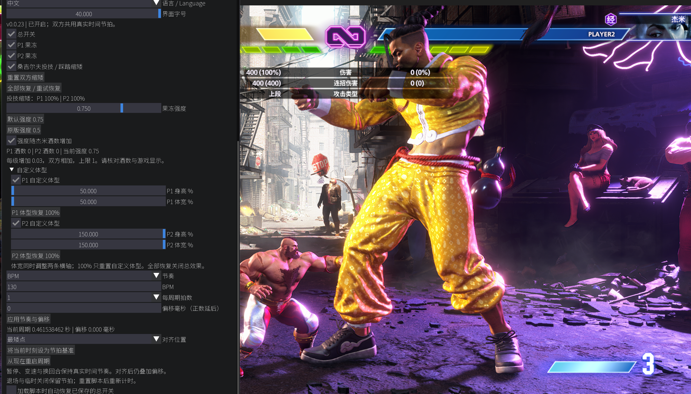

# 杰米的酒 · Jamie's Wine

为《Street Fighter 6》角色添加节奏果冻、自定义体型与投技缩矮效果的 REFramework Mod。

**版本：0.1.0** · Windows PC · 中文 / English



*分别调整双方身高、体宽，并叠加节奏果冻效果。*

## 功能

- **节奏果冻**：P1、P2 独立开关，共用节拍；支持 BPM、拍数、偏移和节拍对齐。
- **自定义体型**：分别调整双方身高与体宽，可单独使用，也可叠加果冻效果。
- **投技缩矮**：桑吉尔夫投技与能量踩踏命中后逐步缩小对手。
- **杰米酒数联动**：根据双方杰米的酒等级增加果冻强度。
- **快捷键与预设**：一键开关、一键恢复，参数自动保存。

适用于本地训练、格斗之地一对一人机／同机双人对战，以及回放。线上对战不在支持范围内。

## 安装

先 [下载本 Mod 压缩包](https://github.com/Overfloating0/Jamies-wine/archive/refs/heads/main.zip)，右键选择 **全部解压缩**，打开能看到 `reframework` 文件夹的那一层。也可以在本仓库页面点击 **Code → Download ZIP** 下载。

首次安装请按 [REFramework 与 Mod 安装教程](docs/安装教程.md) 操作：下载 [官方 REFramework.zip](https://github.com/praydog/REFramework-nightly/releases/latest/download/REFramework.zip)，把其中的 `dinput8.dll` 和本 Mod 的 `reframework` 文件夹放进游戏目录，然后启动游戏。

已经装好 REFramework：退出游戏，将本目录中的 `reframework` 文件夹复制到游戏根目录并合并，启动后打开 **REFramework → Script Generated UI → 杰米的酒**。

游戏根目录是含有 `StreetFighter6.exe` 的文件夹。最终文件结构如下：

```text
Street Fighter 6/
├─ StreetFighter6.exe
├─ dinput8.dll                    ← REFramework
└─ reframework/
   ├─ autorun/
   │  └─ jamieswine.lua            ← Mod 脚本
   └─ fonts/
      └─ NotoSansSC.ttf            ← 中文字体
```

安装包不包含 REFramework 本体。`autorun` 中只保留一份本 Mod 运行脚本，覆盖同名文件前请先备份。

## 快速使用

进入支持的对局，打开总开关，勾选 P1 或 P2 果冻。默认 **130 BPM、每周期 1 拍、强度 0.75**，界面字号为 **40**。

| 快捷键 | 操作 |
| --- | --- |
| F6 | 切换总开关 |
| F7 | 关闭效果并恢复双方体型 |

快捷键在 REFramework 界面隐藏时生效，可在面板内改键。详细参数、缩矮规则与常见问题见 [功能说明](docs/功能说明.md)。

## 文件说明

| 文件或目录 | 用途 |
| --- | --- |
| `reframework/` | 安装到游戏目录的脚本与字体 |
| `docs/` | 安装教程、功能说明与效果图片 |
| `src/`、`scripts/` | 源码与构建工具，普通安装无需操作 |
| `LICENSE`、`licenses/`、`THIRD_PARTY_NOTICES.md` | 许可证与第三方来源说明 |

## 从源码构建

安装 Node.js，在本目录运行：

```sh
node scripts/build.cjs
```

生成的运行脚本位于 `reframework/autorun/jamieswine.lua`。`src/` 和 `scripts/` 是对应源码与构建材料，安装游戏时只需复制 `reframework/`。

## 许可证

源码与运行脚本采用 [AGPL-3.0-only](LICENSE)。Noto Sans SC 字体采用 [SIL Open Font License 1.1](licenses/NotoSansSC-OFL.txt)。第三方来源与许可见 [THIRD_PARTY_NOTICES.md](THIRD_PARTY_NOTICES.md)。
